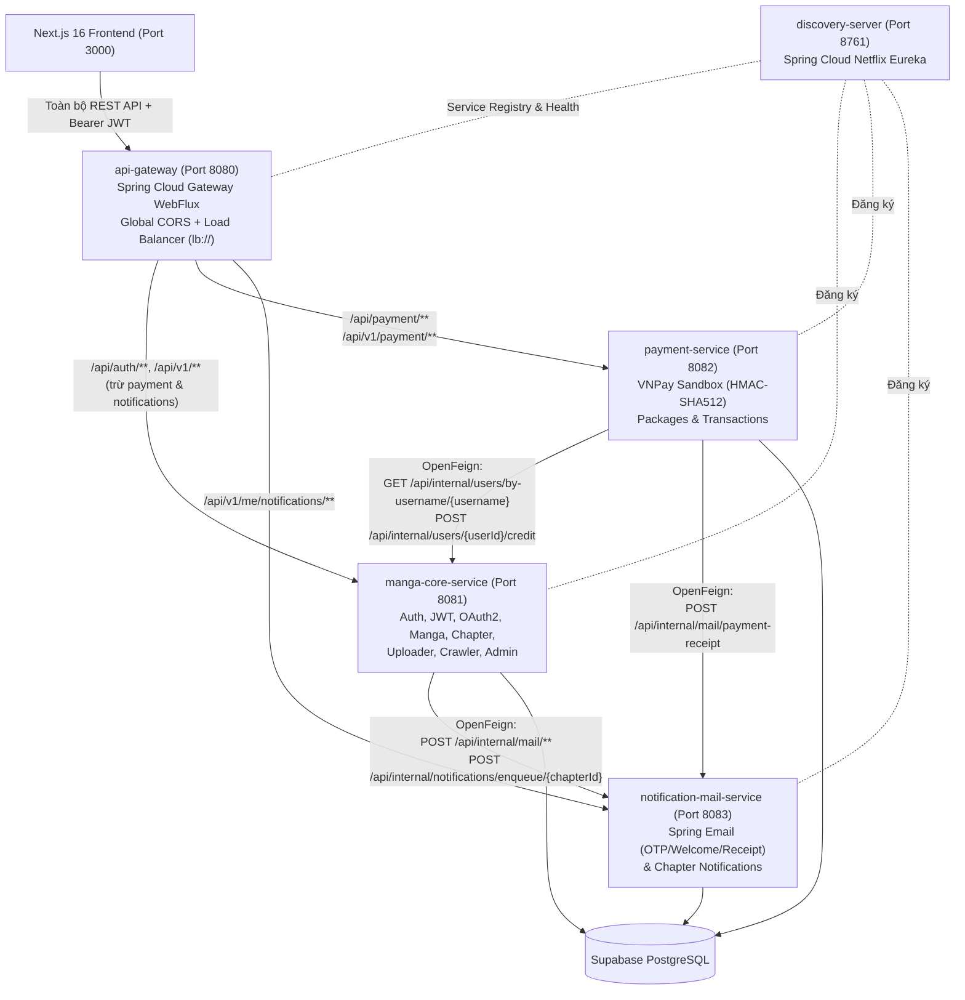

# BẢN THẢO BÁO CÁO ĐỒ ÁN MÔN J2EE — PHẦN PHỤ TRÁCH CỦA THÀNH VIÊN 1 (QUY)

> **Hướng dẫn sử dụng bản thảo này:**  
> Tài liệu này được biên soạn theo đúng bố cục của mẫu `Mau_BaoCaoDoAnJava_MinieShop.docx`, viết đầy đủ, mạch lạc và chuyên sâu để có thể sao chép trực tiếp vào file Word báo cáo chính thức.  
> Các vị trí có khung **`[CHÈN HÌNH ...]`** là nơi bạn dán ảnh chụp màn hình tương ứng và dùng tính năng `References → Insert Caption` trong Word để tự động sinh *Danh mục các hình vẽ*.

---

# TRANG BÌA (TRANG 1)

```text
TRƯỜNG ĐẠI HỌC [ĐIỀN TÊN TRƯỜNG]
KHOA CÔNG NGHỆ THÔNG TIN
-----------------------------------------

BÁO CÁO ĐỒ ÁN MÔN HỌC
PHÁT TRIỂN ỨNG DỤNG VỚI J2EE

ĐỀ TÀI:
XÂY DỰNG HỆ THỐNG ĐỌC TRUYỆN TRANH TRỰC TUYẾN ĐA NGUỒN
— MANGAHUB —

Giảng viên hướng dẫn: [ĐIỀN HỌ TÊN GIẢNG VIÊN]
Nhóm thực hiện:       Nhóm [SỐ NHÓM]
Sinh viên thực hiện:
    1. [Họ và tên Thành viên 1 - Quy]        – MSSV: [........] (Nhóm trưởng)
    2. [Họ và tên Thành viên 2 - QuangMinh]  – MSSV: [........]
    3. [Họ và tên Thành viên 3 - HoangAnh]   – MSSV: [........]
    4. [Họ và tên Thành viên 4 - Long]       – MSSV: [........]

TP. Hồ Chí Minh, năm 2026
```

---

# LỜI CAM ĐOAN (TRANG 2)

Nhóm chúng em xin cam đoan rằng toàn bộ nội dung trong báo cáo đồ án môn học *Phát triển ứng dụng với J2EE* với đề tài **"Xây dựng hệ thống đọc truyện tranh trực tuyến đa nguồn — MangaHub"** là kết quả nghiên cứu, thiết kế và lập trình do chính các thành viên trong nhóm thực hiện dưới sự hướng dẫn của giảng viên bộ môn.

Các số liệu kiểm thử, sơ đồ kiến trúc, mã nguồn Backend (Spring Boot / Spring Cloud Microservices), Frontend (Next.js) và hình ảnh minh họa trong báo cáo đều được chụp và trích xuất trực tiếp từ hệ thống thực tế mà nhóm đã xây dựng và vận hành thành công. Các tài liệu, thư viện mã nguồn mở và API bên thứ ba được sử dụng đều được trích dẫn rõ ràng trong mục Tài liệu tham khảo.

Nhóm xin hoàn toàn chịu trách nhiệm trước giảng viên và nhà trường về tính trung thực của bài báo cáo này.

*TP. Hồ Chí Minh, ngày ... tháng ... năm 2026*  
**Đại diện nhóm sinh viên thực hiện**  
*(Ký và ghi rõ họ tên)*

---

# CHƯƠNG 1: YÊU CẦU CHỨC NĂNG

*(Lưu ý ghép bài: Phần `1.1.1 Các chức năng cơ bản` do Thành viên 2, 3, 4 tổng hợp theo 5 nhóm vai trò sẽ đặt ngay trước mục `1.1.2` dưới đây.)*

## 1.1.2. Các chức năng nâng cao

Bên cạnh các nghiệp vụ cơ bản của một nền tảng đọc truyện tranh trực tuyến (tra cứu, đọc chương, đánh giá, bình luận, quản lý tủ sách và kiểm duyệt nội dung), hệ thống được đầu tư thiết kế và triển khai đầy đủ các chức năng nâng cao đáp ứng yêu cầu thực tế của một hệ thống web hiện đại, bảo mật và có khả năng mở rộng cao. Cụ thể bao gồm 6 nhóm kỹ thuật trọng tâm sau:

### 1. Xác thực hiện đại với Google OAuth2 và Stateless JWT

Để tối ưu trải nghiệm người dùng và giảm rào cản đăng ký tài khoản thủ công, hệ thống hỗ trợ cơ chế đăng nhập một chạm bằng tài khoản Gmail thông qua giao thức **Google OAuth2**:

- Quy trình xác thực phía giao diện và máy chủ: Tại màn hình đăng nhập (`/login`), hệ thống tích hợp Google Identity Services SDK kết hợp hộp thoại chọn tài khoản trực quan. Khi người dùng xác nhận đăng nhập, Frontend gửi `idToken` (hoặc thông tin xác thực từ Google) về endpoint `POST /api/auth/google`. Ở phía máy chủ, `AuthService` sử dụng `RestTemplate` gọi trực tiếp đến Google TokenInfo API (`https://oauth2.googleapis.com/tokeninfo?id_token={token}`) để thẩm định tính hợp lệ của chữ ký từ Google, đồng thời trích xuất an toàn các thuộc tính `email`, `name`, `picture` và mã định danh duy nhất `sub`.
- Tự động đồng bộ tài khoản (Auto-Provisioning): Nếu địa chỉ email chưa tồn tại trong cơ sở dữ liệu, hệ thống tự động khởi tạo hồ sơ người dùng mới với vai trò mặc định `ROLE_USER`, gán cờ `auth_provider = 'GOOGLE'`, sinh mật khẩu ngẫu nhiên mã hóa một chiều bằng thuật toán **BCrypt** và kích hoạt gửi email chào mừng. Nếu email đã tồn tại, hệ thống tự động liên kết `provider_id` và cập nhật ảnh đại diện mới nhất mà không tạo trùng lặp bản ghi.
- **Quản lý phiên không trạng thái (Stateless JWT):** Sau khi xác thực thành công (cả đăng nhập truyền thống lẫn Google OAuth2), máy chủ phát hành chuỗi **JSON Web Token (JWT)** ký bằng khóa bí mật HMAC-SHA256 chứa thông tin định danh và vai trò người dùng. Mọi yêu cầu API bảo mật đều đi qua `JwtAuthenticationFilter` để kiểm tra chữ ký và thời hạn token. Đặc biệt, khi token hết hạn, máy chủ chủ động trả về mã HTTP `401 Unauthorized` kèm header tùy chỉnh `X-JWT-Expired: true`, giúp Axios Interceptor ở Frontend tự động dọn dẹp phiên đăng nhập cũ và điều hướng người dùng quay lại trang đăng nhập một cách mượt mà, tránh lỗi treo giao diện.

### 2. Thanh toán trực tuyến tích hợp cổng VNPay Sandbox (Ví Xu & Gói VIP)

Hệ thống xây dựng mô hình kinh doanh thực tế thông qua **Ví Xu (Coins)** và **Gói hội viên VIP** cho phép độc giả ủng hộ nhóm dịch hoặc mở khóa quyền lợi đặc biệt, sử dụng cổng thanh toán trực tuyến **VNPay Sandbox (phiên bản v2.1.0)**:

- **Hệ thống gói nạp linh hoạt:** Cung cấp 4 gói nạp đa dạng gồm: *Túi Xu Đồng* (10.000 VNĐ → 100 Xu), *Túi Xu Bạc* (20.000 VNĐ → 220 Xu, tặng 10%), *Rương Xu Vàng + VIP* (50.000 VNĐ → 600 Xu, tặng 20% + kích hoạt 30 ngày VIP) và *Kho Báu Kim Cương* (100.000 VNĐ → 1.300 Xu, tặng 30% + kích hoạt 60 ngày VIP).
- **Bảo mật giao dịch bằng chữ ký số HMAC-SHA512:** Mọi yêu cầu thanh toán trước khi chuyển hướng sang cổng VNPay (`https://sandbox.vnpayment.vn/paymentv2/vpcpay.html`) đều được lưu trạng thái khởi tạo `PENDING` trong bảng `payment_transactions` với mã tham chiếu duy nhất `txn_ref`. Toàn bộ tham số bắt đầu bằng `vnp_` được sắp xếp theo thứ tự từ điển (alphabet), mã hóa URL và băm bằng thuật toán **HMAC-SHA512** với `vnp_HashSecret` để tạo ra `vnp_SecureHash`.
- **Xử lý múi giờ và đối soát Callback chống giả mạo:** Hệ thống chuẩn hóa thời gian khởi tạo và thời gian hết hạn giao dịch theo múi giờ Việt Nam (`Asia/Ho_Chi_Minh`) nhằm đảm bảo tương thích tuyệt đối với cổng VNPay ngay cả khi triển khai bên trong container Docker chạy giờ UTC. Khi VNPay chuyển hướng người dùng về `/payment/result`, Frontend gửi bộ tham số phản hồi về Backend để kiểm tra lại chữ ký `HMAC-SHA512`. Chỉ khi chữ ký khớp hoàn toàn và `vnp_ResponseCode = "00"`, hệ thống mới chuyển trạng thái giao dịch sang `SUCCESS`, thực hiện cộng Xu và gia hạn VIP cho tài khoản (tránh hoàn toàn nguy cơ người dùng tự sửa URL để gian lận), đồng thời gửi email biên lai xác nhận.

### 3. Hệ thống gửi Email tự động bằng Spring Email

MangaHub tích hợp thư viện `spring-boot-starter-mail` (`JavaMailSender` kết hợp `MimeMessageHelper` qua giao thức SMTP TLS cổng 587 của Gmail) để tự động hóa các tác vụ giao tiếp với người dùng bằng mẫu **HTML Email chuyên nghiệp**:

1. **Email khôi phục mật khẩu bằng mã OTP (`sendOtpEmail`):** Khi người dùng yêu cầu quên mật khẩu (`POST /api/auth/forgot-password`), hệ thống kiểm tra tính hợp lệ của email, sinh ngẫu nhiên mã OTP gồm 6 chữ số có thời hạn 10 phút, lưu vết trong bảng `password_reset_tokens` và gửi thư điện tử hiển thị nổi bật mã OTP cùng khuyến cáo bảo mật. Ở bước xác nhận (`POST /api/auth/reset-password`), hệ thống kiểm tra đúng mã, còn hạn và chưa từng sử dụng (`used = false`) trước khi mã hóa mật khẩu mới bằng BCrypt và vô hiệu hóa mã OTP đó.
2. **Email biên lai thanh toán VNPay (`sendPaymentReceiptEmail`):** Ngay sau khi giao dịch nạp Xu được đối soát thành công từ VNPay, hệ thống tự động gửi hóa đơn điện tử liệt kê chi tiết mã giao dịch `txn_ref`, số tiền thanh toán (VNĐ) và số Xu được cộng vào ví.
3. **Email chào mừng thành viên mới (`sendWelcomeEmail`):** Tự động gửi lời chào và hướng dẫn sử dụng nhanh khi người dùng hoàn tất đăng ký tài khoản hoặc đăng nhập lần đầu qua Google OAuth2.

### 4. Bảo mật phân tầng 4 nhóm quyền và Truy vấn động với Spring Data JPA

- **Kiểm soát truy cập theo vai trò (RBAC):** Hệ thống thiết lập cấu trúc phân quyền 4 cấp độ (`ROLE_USER`, `ROLE_UPLOADER`, `ROLE_MODERATOR`, `ROLE_ADMIN`) được bảo vệ đồng bộ ở cả 2 lớp: tầng Backend (`SecurityConfig.java` kết hợp `@PreAuthorize` trên từng API) và tầng Frontend (Route Guard tại `app/admin/layout.tsx` trả về màn hình chặn `403 Forbidden` khi tài khoản không đủ thẩm quyền cố tình truy cập đường dẫn quản trị).
- **Truy xuất dữ liệu tối ưu với Spring Data JPA & Specification:** Toàn bộ tầng dữ liệu giao tiếp với cơ sở dữ liệu đám mây **Supabase PostgreSQL** thông qua 18 `@Entity` và 12 `JpaRepository`. Đặc biệt, bộ lọc truyện đa điều kiện (kết hợp từ khóa tiêu đề, trạng thái phát hành, danh sách thể loại, sắp xếp theo lượt xem hoặc thời gian cập nhật) được cài đặt bằng `JpaSpecificationExecutor` (`MangaSpecification.java`), giúp sinh câu truy vấn SQL động linh hoạt, tránh ghép chuỗi SQL thủ công và chống hoàn toàn lỗ hổng SQL Injection.

### 5. Tích hợp MangaDex API v5, HTTP/2 Image Proxy và Lưu trữ Cloudinary WebP

- **Đồng bộ truyện đa nguồn (MangaDex Crawler):** Hỗ trợ quản trị viên và Uploader tìm kiếm trực tiếp kho dữ liệu truyện quốc tế từ MangaDex API v5, tự động ánh xạ thông tin tác giả, thể loại, ảnh bìa và toàn bộ danh sách chương về cơ sở dữ liệu cục bộ.
- **Giải quyết bài toán hiển thị ảnh đa nguồn bằng HTTP/2 Image Proxy:** Nhằm khắc phục tình trạng trình duyệt chặn tải ảnh trực tiếp từ máy chủ ảnh bên thứ ba do chính sách bảo mật Cross-Origin (`ERR_BLOCKED_BY_ORB`), nhóm đã xây dựng cơ chế **Backend Image Proxy** tại endpoint `GET /api/v1/chapters/{chapterId}/pages/{pageNumber}/image`. Máy chủ Java sử dụng `HttpClient` hỗ trợ giao thức HTTP/2 để tải luồng byte ảnh trực tiếp từ nguồn với `User-Agent` hợp lệ, sau đó truyền phát (stream) kèm header `Cache-Control` về cho trình duyệt. Nhờ đó, toàn bộ các trang truyện (ví dụ 40/40 trang của bộ *Yofukashi no Uta*) hiển thị đầy đủ, sắc nét và ổn định.
- **Tối ưu ảnh tự đăng với Cloudinary WebP:** Đối với các chương truyện do nhóm dịch tự tải lên (ảnh rời hoặc file nén `.zip`), hệ thống tự động giải nén, chuyển đổi sang định dạng ảnh nhẹ **WebP** và lưu trữ trên mạng phân phối nội dung **Cloudinary CDN**, giúp giảm mạnh dung lượng tải trang và tiết kiệm tài nguyên băng thông máy chủ.

### 6. Kiến trúc phân tán 5 Microservices với Spring Cloud & Đóng gói Docker Compose

Điểm nổi bật về mặt kỹ thuật của dự án là việc tái cấu trúc toàn bộ tầng Backend từ mô hình nguyên khối (Monolith) sang **kiến trúc Microservices gồm 5 dịch vụ độc lập** sử dụng hệ sinh thái **Spring Boot 4.1.1** và **Spring Cloud 2025.1.2 (Oakwood)** trên nền **Java 21**:

- **Service Discovery (`discovery-server`):** Đăng ký và giám sát trạng thái sống (`UP/DOWN`) của toàn bộ dịch vụ qua **Netflix Eureka**.
- **API Gateway (`api-gateway`):** Đóng vai trò điểm truy cập tập trung duy nhất cho Frontend Next.js, thực hiện định tuyến thông minh, cân bằng tải phía client (`lb://`) và quản trị CORS tập trung.
- **Tách miền nghiệp vụ & Giao tiếp OpenFeign:** Tách riêng dịch vụ thanh toán (`payment-service`) và dịch vụ thông báo – gửi thư (`notification-mail-service`) khỏi lõi nghiệp vụ (`manga-core-service`), giao tiếp liên dịch vụ tường minh thông qua **Spring Cloud OpenFeign**.
- **Container hóa toàn diện với Docker Compose:** Toàn bộ 5 Microservices được đóng gói bằng **Multi-stage Dockerfile** gọn nhẹ, kết nối trong mạng nội bộ riêng biệt (`mangahub-net`), trang bị cơ chế `healthcheck` khởi động có thứ tự và giới hạn bộ nhớ RAM tối ưu (~1.2 GB tổng toàn hệ thống).

---

# CHƯƠNG 2: THIẾT KẾ

*(Lưu ý ghép bài: Mục `2.1 Cơ sở dữ liệu` do Thành viên 2 viết sẽ nằm trước mục `2.2`.)*

## 2.2. Cấu trúc dự án

### 2.2.1. Kiến trúc Microservices & Cấu trúc Backend

#### 2.2.1.1. Lý do lựa chọn mô hình 5 Microservices tối ưu tài nguyên

Trong giai đoạn đầu xây dựng, hệ thống vận hành theo kiến trúc Monolith giúp phát triển nhanh các tính năng cốt lõi. Tuy nhiên, khi tích hợp thêm cổng thanh toán trực tuyến VNPay, hệ thống gửi Email SMTP và tiến trình thông báo chương mới, mô hình nguyên khối bộc lộ các hạn chế điển hình:

- Các tác vụ tốn thời gian chờ mạng như gửi email SMTP hoặc giao tiếp với cổng thanh toán VNPay có thể ảnh hưởng đến hiệu năng của các API đọc truyện vốn có tần suất truy cập rất cao.
- Mọi thay đổi nhỏ ở logic thanh toán hay mẫu email đều đòi hỏi biên dịch và khởi động lại toàn bộ hệ thống lõi.
- Khó mở rộng riêng lẻ từng phân hệ khi lượng người dùng tăng đột biến.

Để giải quyết bài toán này đồng thời vẫn đảm bảo **tính khả thi về phần cứng** (chạy mượt mà trên máy tính cá nhân 8–16 GB RAM và tương thích với giới hạn kết nối của **Supabase PostgreSQL Free Tier**), nhóm đã thiết kế kiến trúc **5 Microservices tối ưu tài nguyên**. Thay vì chia vụn quá mức thành 10–12 service gây quá tải bộ nhớ JVM và cạn kiệt connection pool cơ sở dữ liệu, nhóm giữ các nghiệp vụ có tính liên kết dữ liệu chặt chẽ (Truyện, Chương, Tương tác, Quản trị, Xác thực) trong `manga-core-service`, và tách độc lập hai miền nghiệp vụ nhạy cảm, dễ biến động nhất là **Thanh toán (`payment-service`)** và **Email – Thông báo (`notification-mail-service`)**, kết hợp hai dịch vụ hạ tầng chuẩn của Spring Cloud là **Eureka Discovery Server** và **API Gateway**.

#### 2.2.1.2. Sơ đồ kiến trúc tổng thể và luồng giao tiếp liên dịch vụ



> **[CHÈN HÌNH 2.2.1.1: Sơ đồ kiến trúc tổng thể hệ thống 5 Microservices — MangaHub]**  
> *(Gợi ý: Xuất sơ đồ Mermaid trên bằng mermaid.live hoặc Draw.io thành ảnh PNG độ phân giải cao rồi chèn vào Word, đặt Caption: `Hình X: Sơ đồ kiến trúc tổng thể 5 Microservices của hệ thống MangaHub`.)*

**Giải thích luồng giao tiếp trong kiến trúc:**
1. **Điểm truy cập duy nhất (Single Entry Point):** Ứng dụng Frontend Next.js (cổng `3000`) không gọi trực tiếp đến từng dịch vụ nội bộ mà gửi toàn bộ HTTP Request qua duy nhất cổng `8080` của `api-gateway`.
2. **Định danh & Định tuyến động:** Tất cả 4 dịch vụ (`api-gateway`, `manga-core-service`, `payment-service`, `notification-mail-service`) tự động đăng ký địa chỉ IP nội bộ trong mạng Docker về `discovery-server` (cổng `8761`). Khi có yêu cầu đến, `api-gateway` tra cứu danh bạ Eureka và chuyển tiếp thông qua giao thức cân bằng tải `lb://<SERVICE-NAME>`.
3. **Giao tiếp liên dịch vụ bằng Spring Cloud OpenFeign:**
   - Khi người dùng đăng ký tài khoản mới hoặc yêu cầu quên mật khẩu, `manga-core-service` gọi `NotificationMailClient` (`@FeignClient(name = "notification-mail-service")`) sang `POST /api/internal/mail/welcome` hoặc `/api/internal/mail/otp` để kích hoạt gửi email bất đồng bộ.
   - Khi có chương truyện mới được đăng tải, `manga-core-service` gọi `POST /api/internal/notifications/enqueue/{chapterId}` để `notification-mail-service` phát thông báo cho các độc giả đang theo dõi truyện.
   - Khi độc giả thanh toán VNPay thành công, `payment-service` đối soát chữ ký `HMAC-SHA512`, sau đó gọi **OpenFeign** qua `CoreUserClient` (`POST /api/internal/users/{userId}/credit`) để cộng Xu và gia hạn VIP an toàn vào tài khoản trên `manga-core-service`, đồng thời gọi `NotificationMailClient` (`POST /api/internal/mail/payment-receipt`) để gửi hóa đơn điện tử qua Gmail.

#### 2.2.1.3. Chi tiết vai trò, cấu hình và tối ưu tài nguyên của 5 Microservices

Để kiểm soát chặt chẽ lượng bộ nhớ tiêu thụ và tổng số kết nối mở tới Supabase PostgreSQL, mỗi Microservice được tinh chỉnh riêng tham số **JVM Heap (`-Xms / -Xmx`)**, giới hạn container **`mem_limit`** và kích thước bể kết nối **HikariCP**:

| STT | Tên Service (Artifact) | Cổng | JVM Heap (`-Xms / -Xmx`) | Docker `mem_limit` | HikariCP Pool | Vai trò & Nghiệp vụ chính |
| :-: | :--- | :-: | :-: | :-: | :-: | :--- |
| 1 | **`discovery-server`** | `8761` | `64MB / 192MB` | `320MB` | `0` | Máy chủ **Netflix Eureka Server** quản lý danh bạ dịch vụ và giám sát trạng thái `UP/DOWN`. |
| 2 | **`api-gateway`** | `8080` | `64MB / 192MB` | `320MB` | `0` | **Spring Cloud Gateway (WebFlux)** tiếp nhận yêu cầu từ Frontend, xử lý CORS tập trung (`DedupeResponseHeader`) và định tuyến động. |
| 3 | **`manga-core-service`** (`manga-backend-services`) | `8081` | `128MB / 384MB` | `576MB` | `5` | Dịch vụ nghiệp vụ lõi: Xác thực JWT & Google OAuth2, Phân quyền 4 Role, quản lý Manga/Chapter, Uploader Cloudinary, MangaDex Crawler + Image Proxy, Tương tác độc giả & Admin Portal. |
| 4 | **`payment-service`** | `8082` | `64MB / 224MB` | `384MB` | `3` | Dịch vụ thanh toán độc lập: Quản lý gói Xu/VIP, tạo URL VNPay (`HMAC-SHA512`), đối soát Callback, lưu lịch sử `payment_transactions` và gọi OpenFeign cộng Xu + gửi biên lai. |
| 5 | **`notification-mail-service`** | `8083` | `64MB / 224MB` | `384MB` | `2` | Dịch vụ Email & Thông báo: Gửi HTML Email qua `JavaMailSender` (OTP, Welcome, Biên lai), phục vụ API hộp thư thông báo `/api/v1/me/notifications/**` và nền tảng Worker. |
| — | **Tổng toàn hệ thống** | — | **~1.2 GB Heap tối đa** | **~2.0 GB trần** | **10 kết nối** | Vận hành ổn định trên máy cấu hình phổ thông và nằm hoàn toàn trong giới hạn kết nối của **Supabase Free Tier**. |

**Bảng cấu hình định tuyến tại `api-gateway` (`application.yml`):**

| Route ID | Đích dịch vụ (Eureka Service ID) | Quy tắc đường dẫn (Path Predicates) |
| :--- | :--- | :--- |
| `payment-service` | `lb://PAYMENT-SERVICE` | `/api/payment/**`, `/api/v1/payment/**` |
| `notification-mail-service` | `lb://NOTIFICATION-MAIL-SERVICE` | `/api/v1/me/notifications/**` |
| `manga-core-service` | `lb://MANGA-CORE-SERVICE` | `/api/auth/**`, `/api/v1/**`, `/v3/api-docs/**`, `/swagger-ui/**`, `/swagger-ui.html` |

Bên cạnh đó, `api-gateway` áp dụng bộ lọc mặc định `DedupeResponseHeader=Access-Control-Allow-Origin Access-Control-Allow-Credentials Access-Control-Expose-Headers, RETAIN_FIRST` và cấu hình `exposedHeaders: ["X-JWT-Expired"]` nhằm ngăn chặn lỗi trùng lặp header CORS khi đi qua nhiều lớp dịch vụ và đảm bảo trình duyệt đọc được tín hiệu hết hạn JWT.

**Đặc tả chi tiết từng dịch vụ nghiệp vụ:**

1. **`discovery-server` (Port 8761):** Khởi tạo bằng `@EnableEurekaServer` trong `DiscoveryServerApplication.java`. Cấu hình `register-with-eureka=false` và `fetch-registry=false` vì đóng vai trò máy chủ trung tâm; tắt chế độ self-preservation trong môi trường phát triển (`enable-self-preservation=false`) với chu kỳ làm mới cache 3 giây để cập nhật tức thời trạng thái các dịch vụ.
2. **`api-gateway` (Port 8080):** Xây dựng trên nền tảng lập trình phản ứng **Spring WebFlux** (non-blocking I/O) giúp chịu tải cao với mức tiêu thụ RAM thấp. Tự động đồng bộ danh sách instance từ Eureka mỗi 5 giây (`registry-fetch-interval-seconds: 5`).
3. **`manga-core-service` (Port 8081):** Tổ chức chặt chẽ theo mô hình **Layered Architecture** gồm 8 tầng gói rõ ràng: `client`, `config`, `controller`, `dto` (`request`, `response`, `mangadex`), `entity`, `exception`, `repository`, `security`, `service` và `specification`. Bổ sung `InternalUserController` phục vụ các lệnh truy vấn và cộng Xu nội bộ từ `payment-service`, cùng `NotificationMailClient` để ủy thác việc gửi email sang `notification-mail-service`.
4. **`payment-service` (Port 8082):** Độc lập hoàn toàn về vòng đời triển khai. Chứa `VNPayConfig` (cài đặt băm `HMAC-SHA512` chuẩn VNPay v2.1.0), `PaymentService` (xử lý tạo URL thanh toán theo múi giờ `Asia/Ho_Chi_Minh`, kiểm tra chữ ký trả về và chống xử lý lặp giao dịch đã `SUCCESS`), `JwtUserExtractor` (giải mã stateless JWT trực tiếp mà không cần gọi lại Core để xác định người dùng) cùng hai Feign Client là `CoreUserClient` và `NotificationMailClient`.
5. **`notification-mail-service` (Port 8083):** Đảm nhận toàn bộ giao tiếp ngoại vi qua SMTP và quản trị thông báo người dùng. Gồm `EmailService` (biên soạn 3 mẫu HTML Email chuyên nghiệp), `InternalMailNotificationController` (tiếp nhận yêu cầu gửi thư nội bộ từ Core và Payment), `NotificationController` (cung cấp API xem danh sách, đếm thông báo chưa đọc, đánh dấu đã đọc), `JwtIdentityResolver` (giải mã JWT stateless) và `NotificationWorker`.

#### 2.2.1.4. Đóng gói và điều phối hệ thống bằng Docker Compose

Nhằm giúp giảng viên và các thành viên trong nhóm có thể khởi chạy đồng thời cả 5 Microservices chỉ bằng một câu lệnh duy nhất (`docker compose up --build -d`) mà không phải cài đặt thủ công môi trường Java/Maven trên từng máy, dự án được container hóa toàn diện thông qua file `docker-compose.yml` và bộ 5 `Dockerfile` riêng biệt:

- **Kỹ thuật Multi-Stage Build:** Mỗi `Dockerfile` gồm 2 giai đoạn:
  - *Giai đoạn 1 (Build Stage):* Sử dụng image `maven:3.9.9-eclipse-temurin-21-alpine` để tải thư viện và đóng gói file thực thi `.jar`.
  - *Giai đoạn 2 (Runtime Stage):* Sử dụng image siêu nhẹ `eclipse-temurin:21-jre-alpine` chỉ chứa Java Runtime Environment (JRE) và file `.jar` đã biên dịch, giúp giảm kích thước mỗi container xuống mức tối thiểu và tăng tính bảo mật khi không mang theo mã nguồn và công cụ biên dịch vào môi trường chạy thực tế.
- **Mạng nội bộ & Khởi động tuần tự có kiểm soát (Healthcheck Orchestration):** Cả 5 container giao tiếp nội bộ qua mạng bridge riêng `mangahub-net`. Dịch vụ `discovery-server` trang bị `healthcheck` kiểm tra endpoint `/actuator/health` trả về `UP`; 4 dịch vụ còn lại cấu hình `depends_on: discovery-server (condition: service_healthy)` để đảm bảo chỉ khởi động sau khi Eureka đã sẵn sàng tiếp nhận đăng ký.
- **Tương thích môi trường Docker Desktop Windows:** Khai báo tường minh ánh xạ cổng `127.0.0.1:<port>:<port>` song song giúp tránh lỗi mất kết nối IPv6 (`::1`) trên trình duyệt Windows, đồng thời truyền biến môi trường `TZ: "Asia/Ho_Chi_Minh"` cho `payment-service` và `notification-mail-service` để chuẩn hóa thời gian giao dịch VNPay và nhật ký thông báo.

> **[CHÈN HÌNH 2.2.1.2: Giao diện Eureka Discovery Dashboard tại `http://localhost:8761` hiển thị đủ 4 dịch vụ `API-GATEWAY`, `MANGA-CORE-SERVICE`, `PAYMENT-SERVICE`, `NOTIFICATION-MAIL-SERVICE` ở trạng thái `UP`]**

> **[CHÈN HÌNH 2.2.1.3: Kết quả thực thi `docker compose ps` (5 container trạng thái `healthy`) và giao diện tài liệu API Swagger UI tại `http://localhost:8080/swagger-ui/index.html`]**

#### 2.2.1.5. Tổ chức cây thư mục Backend (5 Microservices)

Toàn bộ mã nguồn Backend được phân tách theo cấu trúc đa dự án (Multi-Project Workspace) rõ ràng ngay tại thư mục gốc của repository:

```text
J2EE_Project/
├── docker-compose.yml                      # Điều phối trọn bộ 5 Microservices & mạng mangahub-net
├── .env.docker.example                     # Mẫu biến môi trường (SMTP, Google Client ID, VNPay)
│
├── discovery-server/                       # [Service 1 - Port 8761] Eureka Server
│   ├── Dockerfile
│   ├── pom.xml
│   └── src/main/
│       ├── java/com/manga/discovery/DiscoveryServerApplication.java
│       └── resources/application.properties
│
├── api-gateway/                            # [Service 2 - Port 8080] Spring Cloud Gateway
│   ├── Dockerfile
│   ├── pom.xml
│   └── src/main/
│       ├── java/com/manga/gateway/ApiGatewayApplication.java
│       └── resources/application.yml       # Định tuyến Routes, Global CORS & DedupeResponseHeader
│
├── payment-service/                        # [Service 3 - Port 8082] Thanh toán VNPay Sandbox
│   ├── Dockerfile
│   ├── pom.xml
│   └── src/main/
│       ├── java/com/manga/payment/
│       │   ├── PaymentServiceApplication.java
│       │   ├── client/                     # CoreUserClient, NotificationMailClient (OpenFeign)
│       │   ├── config/                     # VNPayConfig (HMAC-SHA512)
│       │   ├── controller/                 # PaymentController (/api/v1/payment & /api/payment)
│       │   ├── dto/                        # PaymentDtos
│       │   ├── entity/                     # PaymentTransaction
│       │   ├── repository/                 # PaymentTransactionRepository
│       │   ├── security/                   # JwtUserExtractor (Stateless JWT)
│       │   └── service/                    # PaymentService
│       └── resources/application.properties
│
├── notification-mail-service/              # [Service 4 - Port 8083] Spring Email & Thông báo
│   ├── Dockerfile
│   ├── pom.xml
│   └── src/main/
│       ├── java/com/manga/notification/
│       │   ├── NotificationMailServiceApplication.java
│       │   ├── config/                     # NotificationWorker
│       │   ├── controller/                 # InternalMailNotificationController, NotificationController
│       │   ├── security/                   # JwtIdentityResolver
│       │   └── service/                    # EmailService, NotificationService, ChapterNotificationService
│       └── resources/application.properties
│
└── manga-backend-services/                 # [Service 5 - Port 8081] Nghiệp vụ lõi MangaHub
    ├── Dockerfile
    ├── pom.xml
    └── src/main/
        ├── java/com/manga/manga_backend_services/
        │   ├── client/                     # NotificationMailClient (OpenFeign)
        │   ├── config/                     # ApplicationConfig, DatabaseInitRunner, UploadConfig
        │   ├── controller/                 # 13 REST Controllers (Auth, Manga, Reader, Uploader, Admin, InternalUser...)
        │   ├── dto/                        # request/ (22 lớp), response/ (25 lớp), mangadex/ (8 lớp)
        │   ├── entity/                     # 18 JPA Entities (User, Manga, Chapter, Bookmark, Comment...)
        │   ├── exception/                  # GlobalExceptionHandler
        │   ├── repository/                 # 12 Spring Data JPA Repositories
        │   ├── security/                   # SecurityConfig, JwtService, JwtAuthenticationFilter
        │   ├── service/                    # 14 Business Services (AuthService, MangaDexService, UploaderService...)
        │   └── specification/              # MangaSpecification (Truy vấn lọc động)
        └── resources/application.properties
```

> **[CHÈN HÌNH 2.2.1.4: Ảnh chụp cây thư mục dự án 5 Microservices Backend trong VS Code / IntelliJ IDEA]**  
> *(Gợi ý: Mở rộng thư mục `discovery-server`, `api-gateway`, `payment-service`, `notification-mail-service` và các package chính của `manga-backend-services` trong Explorer để chụp rõ cấu trúc phân tầng.)*

---

*(Lưu ý ghép bài: Mục `2.2.2 Cấu trúc dự án Frontend (Next.js 16)` do Thành viên 3 viết sẽ nối tiếp ngay sau đây.)*

## 2.3. Giao diện

### 2.3.1. Giao diện Xác thực, Email và Thanh toán VNPay

Phân hệ Xác thực, Email và Thanh toán được thiết kế theo phong cách **Dark Mode** đồng nhất với toàn hệ thống, ưu tiên bố cục rõ ràng, thông báo lỗi/thành công trực quan và hỗ trợ người dùng hoàn tất thao tác trong ít bước nhất. Dưới đây là chi tiết 8 màn hình chính thuộc phân hệ này:

#### 1. Giao diện Đăng nhập (`/login`)

Màn hình đăng nhập đặt trung tâm với biểu mẫu nhập tên đăng nhập/email và mật khẩu có nút ẩn/hiện mật khẩu tiện lợi. Ngay phía dưới là đường dẫn chuyển nhanh sang luồng *Quên mật khẩu?* và nút **"Đăng nhập bằng Google"** tích hợp logo nhận diện chuẩn của Google. Khi người dùng nhấn đăng nhập, yêu cầu được gửi qua `api-gateway` (`POST /api/auth/login`) tới `manga-core-service` để đối chiếu mật khẩu mã hóa BCrypt, sau đó lưu JWT Token và thông tin hồ sơ (vai trò, số dư Xu, trạng thái VIP) vào `useAuthStore` (Zustand) và tự động điều hướng về Trang chủ.

> **[CHÈN HÌNH 2.3.1.1: Giao diện Đăng nhập hệ thống MangaHub (`/login`)]**

#### 2. Giao diện Hộp thoại Đăng nhập Google OAuth2

Khi người dùng chọn nút **"Đăng nhập bằng Google"**, hệ thống kích hoạt giao diện chọn tài khoản Google OAuth2 (Account Chooser / Google Identity Services). Sau khi xác nhận tài khoản Gmail, Frontend gửi thông tin xác thực về endpoint `POST /api/auth/google`. Phía máy chủ tự động kiểm tra sự tồn tại của email, đồng bộ ảnh đại diện, tạo tài khoản mới với `auth_provider = 'GOOGLE'` nếu là lần đầu truy cập và phát hành JWT Token để người dùng truy cập ngay vào hệ thống mà không cần nhập biểu mẫu đăng ký thủ công.

> **[CHÈN HÌNH 2.3.1.2: Giao diện Modal chọn tài khoản đăng nhập bằng Google OAuth2]**

#### 3. Giao diện Đăng ký tài khoản mới (`/register`)

Màn hình đăng ký cho phép người dùng mới khởi tạo tài khoản bằng cách cung cấp *Tên đăng nhập (Username)*, *Địa chỉ Email*, *Mật khẩu* và *Xác nhận mật khẩu*. Hệ thống thực hiện kiểm tra hợp lệ dữ liệu (validation) cả ở phía trình duyệt và máy chủ (kiểm tra trùng lặp tên đăng nhập/email, độ dài mật khẩu tối thiểu). Khi đăng ký thành công, `manga-core-service` lưu thông tin tài khoản với vai trò mặc định `ROLE_USER` và đồng thời gọi **OpenFeign** sang `notification-mail-service` để gửi thư chào mừng tới hộp thư Gmail của người dùng.

> **[CHÈN HÌNH 2.3.1.3: Giao diện Đăng ký tài khoản thành viên mới (`/register`)]**

#### 4. Giao diện Quên mật khẩu — Bước 1: Nhập Email nhận mã OTP

Từ trang đăng nhập, khi người dùng nhấn liên kết *"Quên mật khẩu?"*, giao diện chuyển sang bước nhập địa chỉ email đã đăng ký tài khoản. Sau khi xác nhận gửi yêu cầu (`POST /api/auth/forgot-password`), `manga-core-service` xác minh email tồn tại trong cơ sở dữ liệu, sinh mã OTP ngẫu nhiên gồm 6 chữ số có thời hạn hiệu lực 10 phút vào bảng `password_reset_tokens`, sau đó gọi **OpenFeign** sang `notification-mail-service` để gửi thư điện tử.

> **[CHÈN HÌNH 2.3.1.4: Giao diện Quên mật khẩu — Nhập địa chỉ Email yêu cầu mã OTP]**

#### 5. Hòm thư Gmail nhận Email tự động từ Spring Email (OTP & Biên lai)

Minh chứng thực tế hoạt động của dịch vụ `notification-mail-service` thông qua `JavaMailSender` (SMTP Gmail). Thư điện tử được định dạng bằng HTML Template trực quan gồm tiêu đề nhận diện thương hiệu **MangaHub**, khối mã OTP 6 chữ số nổi bật kèm ghi chú thời hạn 10 phút (đối với luồng khôi phục mật khẩu), hoặc bảng tổng hợp mã giao dịch `txn_ref`, số tiền VNĐ và số Xu đã cộng (đối với biên lai thanh toán VNPay).

> **[CHÈN HÌNH 2.3.1.5: Hòm thư Gmail thực tế nhận mã OTP khôi phục mật khẩu và Biên lai nạp Xu từ Spring Email]**  
> *(Gợi ý: Có thể ghép 2 ảnh Gmail cạnh nhau — bên trái là Email OTP, bên phải là Email Biên lai VNPay — để giảng viên thấy rõ cả 2 luồng Spring Email hoạt động thực tế.)*

#### 6. Giao diện Quên mật khẩu — Bước 2: Nhập mã OTP và Đặt lại mật khẩu mới

Sau khi nhận được mã OTP 6 số trong hòm thư Gmail, người dùng nhập mã xác thực cùng mật khẩu mới vào biểu mẫu (`POST /api/auth/reset-password`). Hệ thống kiểm tra đối chiếu đồng thời 3 điều kiện: mã OTP khớp chính xác với email, chưa quá thời hạn 10 phút và chưa được sử dụng trước đó. Khi hợp lệ, mật khẩu mới được mã hóa bằng BCrypt cập nhật vào bảng `users`, bản ghi OTP được đánh dấu `used = true` để chống tái sử dụng, và hệ thống hiển thị thông báo thành công để người dùng đăng nhập lại.

> **[CHÈN HÌNH 2.3.1.6: Giao diện Nhập mã OTP và cập nhật mật khẩu mới thành công]**

#### 7. Giao diện Ví Xu, Chọn gói nạp VNPay và Hỗ trợ thẻ Test Sandbox (`/payment`)

Trang Ví Xu (`/payment`) hiển thị trực quan số dư Xu hiện tại, trạng thái gói hội viên VIP (kèm ngày hết hạn nếu có) và danh sách 4 gói nạp ưu đãi được tải từ `payment-service` (`GET /api/v1/payment/packages`). Để hỗ trợ quá trình kiểm thử và thuyết trình thuận tiện, giao diện tích hợp **Hộp thông tin thẻ Test NCB Sandbox** kèm nút sao chép nhanh 1 chạm (số thẻ `9704198526191432198`, chủ thẻ `NGUYEN VAN A`, ngày phát hành `07/15`, OTP `123456`). Phía dưới trang hiển thị bảng **Lịch sử giao dịch** (`GET /api/v1/payment/history`) thống kê rõ mã giao dịch, gói nạp, số tiền và trạng thái (`PENDING` / `SUCCESS` / `FAILED`). Khi bấm *Thanh toán ngay*, `payment-service` khởi tạo bản ghi giao dịch, ký số `HMAC-SHA512` và trả về đường dẫn điều hướng sang cổng VNPay.

> **[CHÈN HÌNH 2.3.1.7: Giao diện Ví Xu, lựa chọn gói nạp VIP, hộp thẻ Test NCB Sandbox và lịch sử giao dịch (`/payment`)]**

#### 8. Cổng thanh toán VNPay Sandbox và Màn hình Kết quả giao dịch (`/payment/result`)

Sau khi được chuyển hướng từ hệ thống, người dùng thực hiện nhập thông tin thẻ nội địa NCB và xác nhận OTP `123456` trực tiếp trên cổng thanh toán **VNPay Sandbox** (`sandbox.vnpayment.vn`). Khi giao dịch hoàn tất, VNPay chuyển hướng trình duyệt quay lại trang `/payment/result` kèm đầy đủ tham số phản hồi (`vnp_TxnRef`, `vnp_Amount`, `vnp_ResponseCode`, `vnp_SecureHash`, ...).

Trang kết quả tự động gửi toàn bộ tham số về `GET /api/v1/payment/vnpay-callback` trên `payment-service` để xác thực chữ ký `HMAC-SHA512`. Khi xác thực hợp lệ, `payment-service` phối hợp qua **OpenFeign** với `manga-core-service` để cộng Xu/kích hoạt VIP và với `notification-mail-service` để gửi biên lai qua Gmail; đồng thời giao diện hiển thị phiếu xác nhận thanh toán thành công với đầy đủ mã giao dịch, số tiền, số Xu cộng thêm và nút quay lại Ví Xu để kiểm tra số dư mới.

> **[CHÈN HÌNH 2.3.1.8: Giao diện Cổng thanh toán VNPay Sandbox và Màn hình xác nhận kết quả thanh toán thành công (`/payment/result`)]**  
> *(Gợi ý: Ghép 2 ảnh song song hoặc trên–dưới: ảnh trên là màn hình nhập thẻ NCB trên `sandbox.vnpayment.vn`, ảnh dưới là trang `/payment/result` báo thanh toán thành công + số Xu vừa cộng.)*

---

# PHỤ LỤC NHÓM TRƯỞNG: QUY TRÌNH GHÉP BÀI 4 THÀNH VIÊN VÀO FILE WORD CHUẨN

Sau khi nhận đủ bài viết từ Thành viên 2 (`QuangMinh`), Thành viên 3 (`HoangAnh`) và Thành viên 4 (`Long`), bạn thực hiện theo đúng 5 bước sau trên file `Mau_BaoCaoDoAnJava_MinieShop.docx`:

1. **Sao chép & giữ nguyên Style mẫu:** Dán nội dung của 4 thành viên theo đúng thứ tự mục lục (`Trang bìa → Lời cam đoan → Mục lục → Danh mục hình vẽ → Chương 1 (1.1.1 → 1.1.2) → Chương 2 (2.1 → 2.2.1 → 2.2.2 → 2.3.1 → 2.3.2 → 2.3.3) → Chương 3 (3.1 → 3.2) → Tài liệu tham khảo`). Dùng `Paste Special → Keep Text Only` rồi áp dụng đúng Style `Heading 1`, `Heading 2`, `Heading 3`, `Normal` (`Times New Roman 13pt`, giãn dòng `1.3–1.5`, căn đều `Justify`).
2. **Đặt Caption thống nhất cho toàn bộ hình:** Với mỗi ảnh chụp, chọn ảnh → `References → Insert Caption` → chọn Label `Hình` → nhập tên mô tả (in nghiêng, căn giữa).
3. **Cập nhật tự động Mục lục & Danh mục hình vẽ:**
   - Chuột phải vào **Mục lục** (Trang 3) → `Update Field` → `Update entire table`.
   - Chuột phải vào **Danh mục các hình vẽ, đồ thị** (Trang 4–5) → `Update Field` → `Update entire table`.
4. **Kiểm tra trình bày lần cuối:** Rà soát không để tiêu đề mục nằm lẻ ở dòng cuối trang (`Keep with next`), không để bảng bị vỡ chữ, đảm bảo các hình ảnh rõ chữ khi zoom 100%.
5. **Xuất file nộp:** Lưu bản gốc `.docx` và xuất sang `.pdf` (`File → Export → Create PDF/XPS`) để đảm bảo không bị nhảy font khi giảng viên mở chấm điểm.

