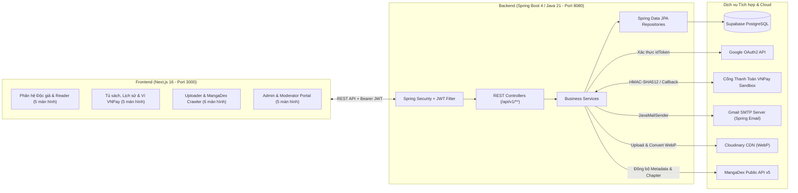

# BÁO CÁO TỔNG HỢP ĐỒ ÁN CUỐI KỲ MÔN J2EE
## Đề tài: Hệ thống Đọc Truyện Tranh Trực Tuyến Đa Nguồn — MangaHub

---

## 1. BẢNG ĐỐI CHIẾU 9 YÊU CẦU BẮT BUỘC CỦA MÔN HỌC

| STT | Yêu cầu chung của dự án cuối kỳ | Trạng thái | Thành phần thực hiện chính trong dự án |
| :-: | :--- | :-: | :--- |
| **1** | **Có tính năng login bằng Gmail hoặc Facebook** | ✅ **Hoàn thành 100%** | Đăng nhập bằng **Google OAuth2** (`POST /api/auth/google`), xác thực `idToken` qua Google TokenInfo API, tự động đồng bộ hồ sơ người dùng và cấp JWT. |
| **2** | **Có phân quyền người dùng (tối thiểu 3 nhóm)** | ✅ **Hoàn thành 100%** | Phân quyền **4 nhóm người dùng** bằng Spring Security + JWT (`ROLE_USER`, `ROLE_UPLOADER`, `ROLE_MODERATOR`, `ROLE_ADMIN`). |
| **3** | **Có hỗ trợ thanh toán online với VNPay hoặc ví Momo** | ✅ **Hoàn thành 100%** | Tích hợp cổng **VNPay Sandbox** (`HMAC-SHA512`), nạp Xu (Coins) & nâng cấp tài khoản **VIP**, lưu lịch sử giao dịch (`payment_transactions`). |
| **4** | **Có làm việc với DB thông qua Spring Data JPA** | ✅ **Hoàn thành 100%** | Sử dụng `spring-boot-starter-data-jpa`, 18 `@Entity`, 12 `JpaRepository` và `MangaSpecification` kết nối **Supabase PostgreSQL**. |
| **5** | **Có gửi email bằng Spring Email** | ✅ **Hoàn thành 100%** | Sử dụng `spring-boot-starter-mail` (`JavaMailSender`) gửi HTML Email: Mã OTP quên mật khẩu, Thư chào mừng thành viên mới, Biên lai thanh toán VNPay. |
| **6** | **Có tổ chức dự án theo yêu cầu (Frontend + Backend)** | ✅ **Hoàn thành 100%** | Tách biệt độc lập `manga-backend-services` (Spring Boot 4 / Java 21) và `manga-frontend-services` (Next.js 16 / TypeScript / Tailwind CSS). |
| **7** | **Có giao diện dễ nhìn (tối thiểu khoảng 10 màn hình)** | ✅ **Hoàn thành 100%** | Xây dựng **21 màn hình (`page.tsx`)** theo phong cách Dark Mode hiện đại, chia thành 4 phân hệ: Độc giả, Cá nhân & Ví VNPay, Uploader & Crawler, Quản trị Admin. |
| **8** | **Có viết báo cáo đầy đủ** | ✅ **Hoàn thành 100%** | Bao gồm báo cáo tổng hợp này, tài liệu đặc tả `Dac_ta_chuc_nang_Manga_v1_2.docx` và bộ tài liệu kỹ thuật chi tiết trong thư mục `docs/`. |
| **9** | **Source code dự án được tổ chức tốt** | ✅ **Hoàn thành 100%** | Backend theo chuẩn Layered Architecture (`config`, `controller`, `dto`, `entity`, `repository`, `security`, `service`, `specification`), có Swagger OpenAPI và 58 Unit/Integration Tests. |

---

## 2. KIẾN TRÚC TỔNG THỂ HỆ THỐNG (SYSTEM ARCHITECTURE)



---

## 3. CHI TIẾT TRIỂN KHAI TỪNG YÊU CẦU

### 3.1. Yêu cầu 1: Đăng nhập bằng Gmail (Google OAuth2)
- **Backend:**
  - `AuthController.java`: Endpoint `POST /api/auth/google`.
  - `AuthService.java` (`loginWithGoogle`):
    1. Nếu client gửi `idToken` từ Google Identity Services, Backend gọi `https://oauth2.googleapis.com/tokeninfo?id_token={token}` để xác thực chữ ký và trích xuất `email`, `name`, `picture`, `sub`.
    2. Nếu email chưa tồn tại trong bảng `users`, hệ thống tự động khởi tạo tài khoản mới với `auth_provider = 'GOOGLE'`, mã hóa mật khẩu ngẫu nhiên bằng `BCryptPasswordEncoder`, và gửi email chào mừng qua `EmailService`.
    3. Phát hành chuỗi **JWT Token** trả về cho Frontend.
- **Frontend:**
  - Trang `app/(auth)/login/page.tsx`: Tích hợp Google Identity Services SDK cùng hộp thoại chọn tài khoản Google OAuth2 trực quan, tự động lưu trạng thái đăng nhập vào `useAuthStore` (Zustand).

### 3.2. Yêu cầu 2: Phân quyền người dùng (4 nhóm người dùng)
Hệ thống định nghĩa và kiểm soát quyền truy cập cho **4 nhóm người dùng** (cùng nhóm Khách vãng lai - Guest) tại `SecurityConfig.java`, `UploaderService.java` và `AdminController.java`:

| Nhóm người dùng | Mã Role trong DB | Quyền hạn chi tiết trong hệ thống |
| :--- | :---: | :--- |
| **1. Độc giả (Reader)** | `ROLE_USER` | • Xem danh sách truyện, đọc chương truyện, tìm kiếm và lọc theo thể loại.<br>• Lưu tiến độ đọc tự động (`/api/v1/me/reading-progress`), quản lý Tủ sách (`/api/v1/me/bookmarks`), nhận thông báo chương mới.<br>• Bình luận (có gắn nhãn Spoiler), đánh giá 1–5 sao, nạp Xu & nâng cấp VIP qua VNPay (`/api/v1/payment/**`).<br>• Gửi truyện tự đóng góp (ở trạng thái `pending` chờ duyệt). |
| **2. Nhóm dịch / Tác giả** | `ROLE_UPLOADER` | • Kế thừa toàn bộ quyền của `ROLE_USER`.<br>• Truy cập **Uploader Dashboard** (`/uploader`): Đăng truyện mới được **tự động duyệt (`approved`)**, tải ảnh bìa và upload chương truyện bằng nhiều ảnh hoặc file `.zip` nén WebP tự động lên Cloudinary. |
| **3. Kiểm duyệt viên** | `ROLE_MODERATOR` | • Truy cập cổng kiểm duyệt (`/admin`, `/api/v1/admin/**`).<br>• Xem thống kê hệ thống, duyệt hoặc từ chối truyện mới (`PUT /api/v1/admin/mangas/{id}/approval`).<br>• Xử lý báo cáo chương lỗi (`PUT /api/v1/admin/reports/{id}/status`), quản lý thẻ thể loại (`tags`), và cấm bình luận tạm thời (`Mute`) người dùng vi phạm. |
| **4. Quản trị viên tối cao** | `ROLE_ADMIN` | • Toàn quyền quản trị hệ thống.<br>• Thay đổi nhóm quyền (`Role`) của mọi tài khoản (`PUT /api/v1/admin/users/{id}/role`) và khóa vĩnh viễn (`Ban`).<br>• Xóa cứng truyện khỏi hệ thống (`DELETE /api/v1/admin/mangas/{id}`).<br>• Sử dụng công cụ **MangaDex Crawler & Cloudinary Mirror** (`/api/v1/crawler/**`). |

### 3.3. Yêu cầu 3: Thanh toán trực tuyến với VNPay
- **Nghiệp vụ:** Độc giả nạp **Xu (Coins)** theo 4 gói (10.000đ, 20.000đ, 50.000đ tặng 30 ngày VIP 👑, 100.000đ tặng 60 ngày VIP 👑).
- **Kỹ thuật bảo mật:**
  - `VNPayConfig.java`: Cài đặt thuật toán ký số `HMAC-SHA512` theo đúng đặc tả VNPay v2.1.0.
  - `PaymentService.java`:
    - `createPaymentUrl()`: Khởi tạo giao dịch `PENDING` trong bảng `payment_transactions`, sắp xếp tham số theo bảng chữ cái alphabet, tạo chữ ký `vnp_SecureHash` và trả về link thanh toán Sandbox.
    - `handleVNPayCallback()`: Kiểm tra chữ ký `HMAC-SHA512` trả về từ VNPay để chống giả mạo URL. Nếu hợp lệ và `vnp_ResponseCode = "00"`, hệ thống chuyển trạng thái sang `SUCCESS`, cộng Xu + ngày VIP cho `User` và gửi email biên lai.

### 3.4. Yêu cầu 4: Làm việc với Database thông qua Spring Data JPA
- Sử dụng `spring-boot-starter-data-jpa` kết nối tới cơ sở dữ liệu **PostgreSQL (Supabase)**.
- **Danh sách 18 JPA Entities (`entity/`):** `User`, `UserSettings`, `PasswordResetToken`, `PaymentTransaction`, `Manga`, `Chapter`, `ChapterPage`, `ChapterReport`, `Author`, `MangaAuthor`, `Tag`, `MangaTag`, `ScanlationGroup`, `Bookmark`, `Comment`, `MangaRating`, `ReadingHistory`, `HomeShowcase`.
- **Danh sách 12 JPA Repositories (`repository/`):** `UserRepository`, `PasswordResetTokenRepository`, `PaymentTransactionRepository`, `MangaRepository` (kèm `JpaSpecificationExecutor`), `ChapterRepository`, `ChapterPageRepository`, `ChapterReportRepository`, `AuthorRepository`, `MangaAuthorRepository`, `TagRepository`, `MangaTagRepository`, `HomeShowcaseRepository`.
- **Truy vấn động:** `MangaSpecification.java` hỗ trợ lọc động theo từ khóa, trạng thái, thể loại.

### 3.5. Yêu cầu 5: Gửi Email bằng Spring Email
- Sử dụng `spring-boot-starter-mail` trong `EmailService.java` với `@Async` và HTML Template chuyên nghiệp:
  1. **Gửi mã OTP khôi phục mật khẩu (`sendOtpEmail`):** Phục vụ luồng `POST /api/auth/forgot-password` và `POST /api/auth/reset-password` (mã OTP 6 chữ số có hiệu lực 10 phút lưu trong bảng `password_reset_tokens`).
  2. **Gửi thư chào mừng (`sendWelcomeEmail`):** Tự động gửi khi người dùng đăng ký mới hoặc đăng nhập qua Google lần đầu.
  3. **Gửi biên lai thanh toán VNPay (`sendPaymentReceiptEmail`):** Tự động gửi chi tiết mã giao dịch `txnRef`, số tiền VND và số Xu nhận được ngay sau khi thanh toán VNPay thành công.

### 3.6. Yêu cầu 6 & 7: Tổ chức Frontend + Backend và 21 Màn hình Giao diện
Dự án tách thành 2 phần rõ rệt, trong đó `manga-frontend-services` bao gồm **21 màn hình (`page.tsx`)**:
1. `/` (`app/page.tsx`): Trang chủ (Hero Banner, Top Trending, Mới cập nhật, Khám phá thể loại).
2. `/login` (`app/(auth)/login/page.tsx`): Đăng nhập, Google OAuth2 Account Chooser & Quên mật khẩu OTP.
3. `/register` (`app/(auth)/register/page.tsx`): Đăng ký tài khoản mới.
4. `/manga/[id]` (`app/manga/[id]/page.tsx`): Chi tiết truyện, Đánh giá 1–5 sao, Theo dõi truyện, Danh sách chương, Bình luận.
5. `/chapter/[chapterId]` (`app/chapter/[chapterId]/page.tsx`): Màn hình đọc truyện (Reader Canvas), tùy chỉnh chế độ đọc, tự động lưu tiến độ đọc và bình luận chương.
6. `/library` (`app/library/page.tsx`): Tủ sách cá nhân (Bookmark) & bật/tắt nhận thông báo chương mới.
7. `/history` (`app/history/page.tsx`): Lịch sử đọc truyện và đọc tiếp chương đang dở.
8. `/notifications` (`app/notifications/page.tsx`): Trung tâm thông báo chương mới của người dùng.
9. `/payment` (`app/payment/page.tsx`): Ví xu cá nhân, chọn gói nạp VNPay, thông tin thẻ NCB test 1 chạm & lịch sử giao dịch.
10. `/payment/result` (`app/payment/result/page.tsx`): Màn hình xác thực chữ ký VNPay Callback và hiển thị biên lai giao dịch.
11. `/uploader` (`app/uploader/page.tsx`): Tổng quan thống kê của Uploader / Nhóm dịch.
12. `/uploader/mangas` (`app/uploader/mangas/page.tsx`): Danh sách truyện đã đăng và trạng thái kiểm duyệt.
13. `/uploader/mangas/new` (`app/uploader/mangas/new/page.tsx`): Biểu mẫu tạo truyện mới.
14. `/uploader/mangas/[id]` (`app/uploader/mangas/[id]/page.tsx`): Chỉnh sửa thông tin truyện, tải ảnh bìa & upload chương mới (ảnh rời hoặc `.zip`).
15. `/uploader/mangadex` (`app/uploader/mangadex/page.tsx`): Giao diện nhập truyện từ MangaDex trong khu vực Uploader.
16. `/crawler` (`app/crawler/page.tsx`): Công cụ tìm kiếm và cào dữ liệu MangaDex trực tiếp.
17. `/admin` (`app/admin/page.tsx`): Dashboard thống kê tổng quan hệ thống (Admin Master).
18. `/admin/content` (`app/admin/content/page.tsx`): Kiểm duyệt truyện chờ duyệt (`pending`), xử lý báo cáo chương lỗi và cào MangaDex.
19. `/admin/users` (`app/admin/users/page.tsx`): Quản lý danh sách người dùng, phân quyền 4 nhóm Role (`USER`, `UPLOADER`, `MODERATOR`, `ADMIN`) và kỷ luật (`Mute` / `Ban`).
20. `/admin/ui-config` (`app/admin/ui-config/page.tsx`): Quản lý thẻ thể loại (`Tags`) và cấu hình hiển thị trang chủ.
21. `/admin/infrastructure` (`app/admin/infrastructure/page.tsx`): Giám sát dung lượng lưu trữ Cloudinary, băng thông CDN và trạng thái hệ thống.

---

## 4. KIỂM THỬ TỰ ĐỘNG & HƯỚNG DẪN CHẠY DEMO

### 4.1. Chạy bộ kiểm thử tự động (Unit & Integration Tests)
```powershell
cd manga-backend-services
.\mvnw.cmd test
```
Toàn bộ **58 bài kiểm thử tự động** (`AuthEmailServiceTests`, `PaymentServiceTests`, `UploaderServiceTests`, `CloudinaryServiceTests`, `MangaDexServiceTests`, `BookmarkServiceTests`, `CommentServiceTests`, `RatingServiceTests`, `ReadingProgressServiceTests`, `NotificationServiceTests`, ...) đều vượt qua thành công (`BUILD SUCCESS`).

### 4.2. Khởi chạy hệ thống
1. **Khởi động Backend (Port 8080):**
   ```powershell
   cd manga-backend-services
   .\mvnw.cmd spring-boot:run
   ```
   - Swagger UI: `http://localhost:8080/swagger-ui/index.html`
2. **Khởi động Frontend (Port 3000):**
   ```powershell
   cd manga-frontend-services
   npm.cmd run dev
   ```
   - Giao diện chính: `http://localhost:3000`

