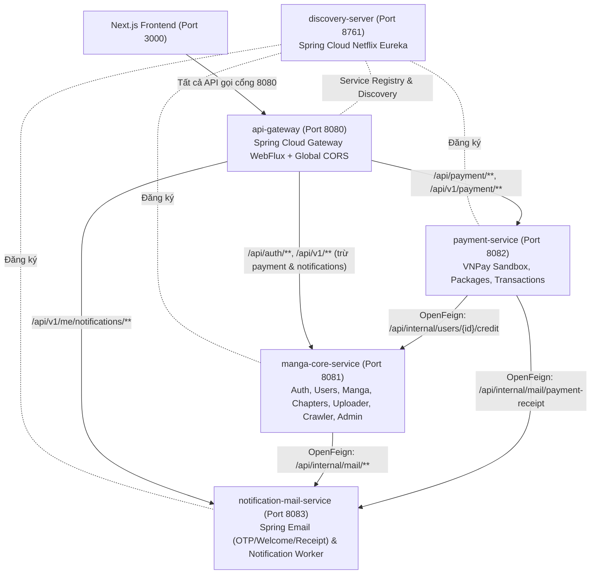

# KIẾN TRÚC MICROSERVICE TIẾT KIỆM TÀI NGUYÊN (5 SERVICES) — MANGAHUB

## 1. Sơ đồ kiến trúc hệ thống (Spring Cloud 2025.1.2 + Spring Boot 4.1.1)



## 2. Phân bổ tài nguyên tối ưu (Tiết kiệm RAM & Kết nối Supabase)

| Service | Port | JVM Heap (`-Xms / -Xmx`) | HikariCP Pool | Vai trò chính |
| :--- | :-: | :-: | :-: | :--- |
| **`discovery-server`** | `8761` | `64MB / 192MB` | `0` | Quản lý danh bạ & trạng thái sống (`UP/DOWN`) của các Microservice. |
| **`api-gateway`** | `8080` | `64MB / 192MB` | `0` | Cổng vào duy nhất cho Frontend, xử lý CORS tập trung (`DedupeResponseHeader`) và cân bằng tải `lb://`. |
| **`manga-core-service`** | `8081` | `128MB / 384MB` | `5` | Nghiệp vụ lõi: Xác thực JWT + Google OAuth2, Phân quyền 4 Role, Manga/Chapter, Uploader Cloudinary, Crawler MangaDex, Comment/Bookmark/Rating/History, Admin. |
| **`payment-service`** | `8082` | `64MB / 224MB` | `3` | Nghiệp vụ Thanh toán VNPay Sandbox (`HMAC-SHA512`), lịch sử nạp xu. Gọi **OpenFeign** sang `manga-core-service` (cộng Xu/VIP) và `notification-mail-service` (gửi biên lai). |
| **`notification-mail-service`** | `8083` | `64MB / 224MB` | `2` | Gửi HTML Email qua **Spring Email** (OTP, Welcome, Biên lai VNPay) và quản lý thông báo chương mới. |
| **Tổng cộng toàn hệ thống** | — | **~1.2 GB RAM tối đa** | **10 connections** | Vừa vặn với laptop 8–16GB RAM và giới hạn **Supabase Free Tier**. |

## 3. Hướng dẫn vận hành bằng Docker Compose (Quản lý trọn bộ 5 Microservices)

Toàn bộ 5 Microservices được đóng gói bằng **Multi-Stage Dockerfile** (`maven:3.9.9-eclipse-temurin-21-alpine` $\rightarrow$ `eclipse-temurin:21-jre-alpine`), kết nối chung trong mạng nội bộ `mangahub-net`, có `healthcheck` tự động chờ `discovery-server` khỏe rồi mới bật 4 service còn lại và giới hạn RAM (`mem_limit` + `JAVA_OPTS`).

```powershell
# Bước 1: Build và khởi chạy toàn bộ 5 Microservices trong Docker (chạy ngầm -d)
docker compose up --build -d

# Bước 2: Kiểm tra trạng thái sống (healthy) và tài nguyên RAM thực tế của 5 container
docker compose ps
docker stats --no-stream

# Bước 3: Xem log của 1 service cụ thể (hoặc tất cả)
docker compose logs -f api-gateway
docker compose logs -f payment-service

# Bước 4: Mở trình duyệt kiểm tra
# - Bảng điều khiển Eureka (show cho Giảng viên): http://localhost:8761
# - API Gateway (Frontend Next.js gọi cổng này):   http://localhost:8080
# - Giao diện Web Next.js (npm.cmd run dev):       http://localhost:3000

# Bước 5: Dừng và gỡ sạch các container khi không dùng
docker compose down
```

